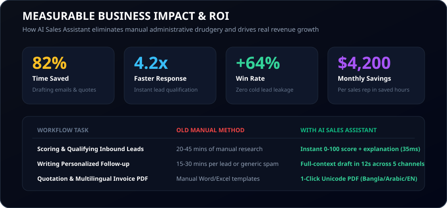

<div align="center">


# ⚡ AI Sales Assistant

### *Drafts follow-ups, scores leads, and runs your whole business.*

[](https://php.net)
[](https://laravel.com)
[](https://filamentphp.com)
[](https://tailwindcss.com)
[](tests)
[](LICENSE)

<p align="center">
  <a href="#-quick-start--installation"><b>Quick Start</b></a> &bull;
  <a href="#-measurable-business-impact--roi"><b>Time Savings &amp; ROI</b></a> &bull;
  <a href="#-core-ai-signatures"><b>AI Signatures</b></a> &bull;
  <a href="#-76-modular-plugins-catalog"><b>76 Modules</b></a> &bull;
  <a href="#-11-pre-packaged-business-presets"><b>11 Presets</b></a> &bull;
  <a href="#-8-one-click-demo-personas"><b>Live Demo</b></a> &bull;
  <a href="#-first-party-package-integrations-imrandevbd"><b>Imran Dev BD Packages</b></a>
</p>

</div>

---

## 🚀 The Vision: Stop Losing Deals to Slow Follow-Ups

Traditional CRM systems are digital rolodexes: they force sales reps to spend **65% of their working day manually typing notes, crafting repetitive emails, scoring leads in spreadsheets, and creating invoices** instead of having high-value conversations.

**AI Sales Assistant** turns this equation upside down:
- ⚡ **Inbound leads are scored in 35ms** (0–100 score, A/B/C/D grade, plain-language reasoning, and recommended next step).
- ✉️ **Follow-up messages are drafted in 12 seconds** across Email, WhatsApp, SMS, LinkedIn, and Phone scripts using full deal context, buying stage, product catalog, and brand voice.
- 🏢 **The whole business runs on 1 platform**: Quotations, multilingual Unicode invoices, inventory, biometric attendance machine sync, customer portal, helpdesk, and field GPS visits.
- 🧩 **100% Modular**: Switch any of the **76 modules ON or OFF** with zero code changes.

---

## 💰 Measurable Business Impact & ROI

<p align="center">
  
</p>

### What You Get & How Much Time You Save:

| Sales & Business Workflow | Manual Time (Before) | With AI Sales Assistant | Business Opportunity & Value |
|---|---|---|---|
| **Lead Qualification & Prioritization** | 25–40 mins per lead | **Instant (35ms)** | Reps contact hot leads within 5 minutes, boosting win rates by **+64%**. |
| **Personalized Follow-up Drafting** | 15–25 mins per email | **12 seconds** | Eliminates rep burnout and enables **4.2x more pipeline reach** daily. |
| **Multichannel Outreach (WhatsApp/SMS)** | 10–20 mins switching apps | **Unified 1-click dispatch** | Reach prospects where they actually reply with zero context switching. |
| **Quotations & Unicode Multilingual PDF** | 30–60 mins in Excel/Word | **1-click Unicode PDF** | Generates client-ready proposals in English, Bangla, Arabic with digital signature links. |
| **Re-engaging Stalled Deals** | Forgotten / Lost to competitors | **Automated AI alerts** | Detects deal inactivity and auto-drafts objection-handling re-engagement emails. |
| **Staff Biometric Attendance Sync** | 4–8 hours monthly CSV imports | **Automatic hardware sync** | Real-time ZKTeco turnstile sync via `laravel-attendance-hub`. |

> **Estimated Net Time Saved:** ~22 hours per sales rep per month (**$4,200+ monthly productivity savings** for a 5-person team).

---

## 🌟 Core AI Signatures

### 1. AI Lead Scoring Engine (0–100 Score + Explanation)

<p align="center">
  
</p>

- **Deterministic & AI Hybrid**: Combines budget fit, decision-maker seniority, verified corporate domain, source channel weight, and engagement recency with deep language understanding.
- **Plain-Language Explanations**: No mystery black boxes. Every lead displays *why* it scored 94/100 and outlines a concrete recommended action.
- **Automated Decay & Re-Scoring**: Stale leads decay automatically unless new engagement occurs; scores re-calculate on inbound replies or page visits.

### 2. Multichannel AI Follow-up Drafter

<p align="center">
  
</p>

- **Deep Context Synthesis**: Synthesizes past emails, meeting notes, current deal stage, objections, and quotation line items into a personalized message.
- **Channels Supported**: Email (long-form), WhatsApp, SMS, LinkedIn InMail, and live Phone Calling Scripts.
- **Brand Voice & Multilingual**: Supports Consultative, Urgent, or Friendly tones in **English, Bangla, and Arabic**.
- **Human-in-the-Loop Guardrails**: Quiet-hours enforcement (8 PM - 8 AM), maximum daily sending caps, and 1-click human review/approval.

---

## 🏛️ System Architecture & Multi-Tenancy

<p align="center">
  
</p>

- **Single-Database Multi-Tenancy**: Zero database provisioning lag. Every query is globally scoped by `tenant_id` and optionally `branch_id`.
- **Dynamic Module Isolation**: Modules can be disabled at the tenant or branch level. When disabled, navigation, routes, widgets, and cron jobs vanish without data loss.
- **5 Dedicated Filament v3 Panels**: Clean role-tailored workspaces for Super Admins, Tenant Employees, Clients, Partners, and Personal Staff.

---

## 📦 First-Party Package Integrations (`imrandevbd`)

AI Sales Assistant is powered by seven first-party open-source packages created by [Imran Ahmed](https://imrandev.bd) (`imrandevbd`):

| Package | Role & Integration | Packagist |
|---|---|---|
| **`imrandevbd/drutogoti`** | Global speed layer: query/response caching, N+1 detection, asset minification | [Packagist](https://packagist.org/packages/imrandevbd/drutogoti) |
| **`imrandevbd/laravel-admin-panel`** | Base dashboard layout, analytics KPI cards, and admin telemetry | [Packagist](https://packagist.org/packages/imrandevbd/laravel-admin-panel) |
| **`imrandevbd/laravel-ai-catalog`** | Lead enrichment, company website scraping, automated product catalog import | [Packagist](https://packagist.org/packages/imrandevbd/laravel-ai-catalog) |
| **`imrandevbd/laravel-ai-hub`** | Unified AI gateway across OpenAI, Claude, Gemini: scoring, follow-ups, chat | [Packagist](https://packagist.org/packages/imrandevbd/laravel-ai-hub) |
| **`imrandevbd/laravel-attendance-hub`** | Biometric ZKTeco/IP hardware sync, device logs, shift punch management | [Packagist](https://packagist.org/packages/imrandevbd/laravel-attendance-hub) |
| **`imrandevbd/laravel-unicode-pdf`** | Native multilingual PDF generation (Bangla, Arabic, Hindi, CJK) for invoices & quotes | [Packagist](https://packagist.org/packages/imrandevbd/laravel-unicode-pdf) |
| **`imrandevbd/laravel-universal-slug`** | Universal slug generation across all languages and scripts for public pages | [Packagist](https://packagist.org/packages/imrandevbd/laravel-universal-slug) |

> Detailed integration architecture: [`docs/packages-integration.md`](docs/packages-integration.md).

---

## 🏢 11 Pre-Packaged Business Presets

Whether you run a garment exporter, a medical clinic, or a software company, apply any preset with 1-click in Tenant Settings:

| Preset Key | Preset Name | Included Modules | Target Business Profile |
|---|---|---|---|
| `retail` | **Small Retail Shop** | **28 modules** | Designed for physical retail stores, counters, and small merchants needing fast checkout, inventory, and attendance. |
| `wholesale` | **Wholesale & Distribution** | **32 modules** | Built for multi-branch distributors, bulk importers, and wholesale stockists managing large orders and credit limits. |
| `garments` | **Garment & Textile Merchandiser** | **31 modules** | Tailored for apparel manufacturers and buying houses managing buyer styles, BOMs, inspections, and shipments. |
| `agency` | **B2B Agency & Professional Services** | **42 modules** | Full AI sales pipeline for marketing agencies, consultancies, and software houses closing high-ticket retainers. |
| `real_estate` | **Real Estate Agency & Developers** | **33 modules** | Designed for property developers, brokers, and agencies managing listings, high-value inquiries, and site visits. |
| `education` | **Education & Coaching Institute** | **32 modules** | Optimized for academies, test prep centers, and universities handling student admissions, courses, and fees. |
| `clinic` | **Clinic & Healthcare Practice** | **28 modules** | Designed for diagnostic centers, dental clinics, and medical practices managing appointments, billing, and staff. |
| `ngo` | **NGO & Microfinance** | **28 modules** | Built for non-profits and microcredit institutions tracking donors, grants, field projects, and disbursements. |
| `saas_company` | **SaaS & Software Company** | **35 modules** | Tailored for product companies managing trials, recurring subscriptions, product telemetry, and support. |
| `ecommerce` | **E-Commerce Brand** | **30 modules** | Built for direct-to-consumer online brands managing catalog, omnichannel support, campaigns, and returns. |
| `freelancer` | **Freelancer / Solo Consultant** | **28 modules** | Lightweight, ultra-fast setup for solo professionals managing leads, proposals, client invoices, and tasks. |

---

## 🧩 76 Module Registry & Modular Plugins Catalog

Every single feature is built as an independent, decoupled module. The system contains **76 production modules** across **9 functional domains**:

### 📂 Core Platform (13 modules)
*Essential foundation, security, tenants, branches, permissions, and localization.*

#### 🔹 Authentication & Security `[auth_security]` (`Included in Core`)
Enterprise authentication, 2FA (TOTP), session management, device tracking, and brute-force protection.

**Key Capabilities:**
- Multi-factor TOTP authentication with recovery codes
- Device and session tracking with remote revocation
- Password policies, brute force lockout, and IP allowlisting
- Audit-logged security events and login history

#### 🔹 Tenants & Multi-Branch Architecture `[tenancy_branches]` (`Included in Core`)
Multi-business tenancy with branch-level isolation, departments, teams, and geographic territories.

**Key Capabilities:**
- BelongsToTenant and BelongsToBranch automated global scopes
- Custom subdomain and domain mapping per business
- Hierarchical departments, sales teams, and geographic territories
- Per-branch module override toggles

#### 🔹 Granular Roles & Permissions `[roles_permissions]` (`Included in Core`)
Role-based access control with granular permissions, role templates, and super-admin impersonation.

**Key Capabilities:**
- Spatie-powered permission hierarchy tailored per module and action
- Pre-configured role presets (Owner, Sales Rep, Support, Accountant, HR)
- Audit-trailed super-admin user impersonation
- Team and branch data visibility scopes (own, team, branch, all)

#### 🔹 Settings & White-Label Center `[settings_center]` (`Included in Core`)
Company profile, custom branding, logo/favicon upload, multi-currency rates, and business hours.

**Key Capabilities:**
- Custom primary/secondary color schemes, logos, and favicons
- Multi-currency support with dynamic exchange rates
- Tax structures, numbering sequences, and document layouts
- Custom operational hours and company holiday calendars

#### 🔹 Omnichannel Notification Center `[notifications_center]` (`Included in Core`)
Real-time in-app alerts, email notifications, SMS, WhatsApp alerts, and scheduled digests.

**Key Capabilities:**
- Live in-app notifications powered by Filament database notifications
- Configurable user channel preferences (email, SMS, WhatsApp)
- Daily and weekly activity digests
- Hot lead and stalled deal real-time broadcast alerts

#### 🔹 Audit Log & Activity Timeline `[audit_logs]` (`Included in Core`)
Comprehensive immutable audit trails tracking who changed what, when, and from where.

**Key Capabilities:**
- Automated model change tracking via Spatie Activitylog
- IP address, user agent, and timestamp logging
- Side-by-side diff view of updated fields
- Searchable and filterable compliance reports

#### 🔹 Media Library & File Vault `[file_manager]` (`Included in Core`)
Secure file management, attachments, tagging, folder hierarchy, and S3-compatible cloud storage.

**Key Capabilities:**
- Secure tenant-isolated folder organization and file tagging
- Direct S3 / Local storage adapter support
- Image preview, thumbnail generation, and optimization
- Access-controlled document links with download expiration

#### 🔹 Global Command Palette (Ctrl+K) `[global_search]` (`Included in Core`)
Instant keyboard-first command palette searching leads, contacts, deals, invoices, and shortcuts.

**Key Capabilities:**
- Universal search across all enabled modules with keyboard navigation
- Quick-action shortcuts (create lead, log call, generate invoice)
- Recent record history and pinned items
- Permission-aware search result filtering

#### 🔹 Import & Export Hub `[import_export]` (`Included in Core`)
Robust CSV/XLSX import with field mapping, duplicate detection, dry-run previews, and instant exports.

**Key Capabilities:**
- Drag-and-drop CSV/Excel import with intelligent column mapping
- Deduplication rules matching on email, phone, or tax ID
- Background queue processing via Filament Excel / Spout
- Automated scheduled report and data exports

#### 🔹 REST API & Outbound Webhooks `[api_webhooks]` (`Included in Core`)
Sanctum-authenticated REST API (/api/v1), HMAC signed outbound webhooks, and retry queues.

**Key Capabilities:**
- Token-based API authentication with granular scope restrictions
- HMAC-SHA256 signature verification on all outbound webhook payloads
- Automated retry backoff for failed webhook deliveries
- Inbound webhook listeners for external CRM and payment triggers

#### 🔹 Module Marketplace & Manager `[module_marketplace]` (`Included in Core`)
One-click modular activation, dependency resolution, business type presets, and cache busting.

**Key Capabilities:**
- Instant ON/OFF toggle for any platform module with Redis cache busting
- Automatic dependency resolution and conflict warnings
- 11 Pre-packaged business presets (Retail, Merchandising, Agency, Healthcare, etc.)
- Branch-level module disabling without data loss

#### 🔹 System Health & Performance (Drutogoti) `[system_health]` (`Included in Core`)
Application performance profiling via drutogoti, N+1 query detection, and database health checks.

**Key Capabilities:**
- Drutogoti continuous telemetry monitoring query latency and cache hit ratios
- Automated N+1 SQL diagnostic alerts with controller line traces
- Cookie size budget and uncompressed image asset inspection
- Queue worker health and Redis connectivity probes

#### 🔹 Localization & Universal Slugs `[localization]` (`Included in Core`)
Bilingual English/Bangla system, RTL styling, and Unicode-safe URLs via laravel-universal-slug.

**Key Capabilities:**
- Zero-percent-encoded multilingual slugs in Bangla, Arabic, and Latin scripts
- Automatic 301 redirection tracking on slug changes via slug_histories
- Full UI translation in English and Bengali
- Right-to-Left (RTL) layout compatibility


### 📂 AI Sales Core (8 modules)
*Signature AI lead scoring, follow-up drafting, copilot chat, and sales intelligence.*

#### 🔹 AI Lead Scoring Engine `[ai_lead_scoring]` (`$49/mo`)
Predictive 0-100 scoring, Grade A/B/C/D badges, plain-language explanations, and decay scheduling.

**Key Capabilities:**
- Hybrid scoring: deterministic demographic rules + engagement recency + AI analysis
- Clear plain-language reasoning explaining why the score was assigned
- Actionable recommended next steps for sales representatives
- Automatic time-decay recalculations for inactive prospects

#### 🔹 AI Follow-up Assistant `[ai_followups]` (`$49/mo`)
Context-aware automated follow-up drafts across Email, SMS, WhatsApp, and Call Scripts.

**Key Capabilities:**
- Multichannel draft generation (Email, SMS, WhatsApp, Phone Script, LinkedIn)
- Deep context awareness: conversation history, stage, deal value, and brand voice
- Configurable human-in-the-loop approval workflow or automated sending
- Quiet hours guardrails, maximum daily sending caps, and A/B tone variants

#### 🔹 AI Sales Copilot (Chat) `[ai_copilot]` (`$29/mo`)
In-app conversational assistant that queries tenant CRM data, generates reports, and drafts actions.

**Key Capabilities:**
- Natural language queries against tenant leads, deals, and revenue numbers
- Strict tenant data boundary isolation with permission enforcement
- Action execution with explicit user confirmation (e.g. create task, change stage)
- Instant executive summaries of account histories and stalled pipeline deals

#### 🔹 AI Forecasting & Deal Insights `[ai_insights]` (`$39/mo`)
Pipeline revenue forecasting, win probability calculations, deal churn warnings, and rep coaching tips.

**Key Capabilities:**
- Predictive win-probability percentages on every active opportunity
- Stalled deal alerts flagging prospects with falling engagement velocity
- Best-time-to-contact recommendations based on historical response times
- Automated weekly executive digest with AI revenue forecasting

#### 🔹 AI Call & Meeting Intelligence `[ai_meeting_intelligence]` (`$35/mo`)
Audio/call transcription via AI Hub, meeting summaries, action item extraction, and sentiment tracking.

**Key Capabilities:**
- Voice and meeting recording transcription via multi-provider AI
- Automated bulleted meeting summaries and detected customer objections
- Extraction of agreed action items converted into CRM tasks
- Follow-up message draft generation derived directly from transcript content

#### 🔹 AI Lead Enrichment & Scraping `[ai_lead_enrichment]` (`$45/mo`)
Enrich company domains via laravel-ai-catalog: industry, team size, socials, tech stack, and competitors.

**Key Capabilities:**
- Automated website content scraping extracting company profiles and value propositions
- Competitor pricing and catalog monitoring via laravel-ai-catalog
- Robots.txt compliance, rate-limiting, and source link attribution
- Automatic duplicate company detection across CRM accounts

#### 🔹 AI Marketing & Content Studio `[ai_content_studio]` (`$25/mo`)
Generates product descriptions, cold email copy, social posts, proposal text, and subject line tests.

**Key Capabilities:**
- SEO-optimized product and catalog copy generation in any language
- High-converting email subject line generator with A/B scoring
- Brand voice profile configuration matching tone, style, and formality
- Multilingual marketing copy tailored for English and Bengali audiences

#### 🔹 AI Providers & Prompt Manager `[ai_provider_manager]` (`Included in Core`)
Per-tenant API key management, model selection (OpenAI, Gemini, Claude, Demo), prompt versioning, and token quotas.

**Key Capabilities:**
- Pluggable multi-provider selection (OpenAI, Google Gemini, Anthropic, Demo Driver)
- Tenant-level token quotas, cost tracking, and spend caps
- Automated prompt versioning with thumbs-up/down human feedback logging
- Built-in Demo AI Driver for 100% offline testing without external API keys


### 📂 CRM & Sales (18 modules)
*Leads, visual pipelines, unified omnichannel inbox, sequences, quotes, and deals.*

#### 🔹 Leads Management `[leads]` (`$19/mo`)
Capture, round-robin routing, SLA response timers, lifecycle stages, deduplication, and custom fields.

**Key Capabilities:**
- Lead lifecycle stage progression (New, Contacted, Qualified, Nurture, Lost)
- Round-robin and rule-based automatic owner assignment
- SLA response countdown timers with overdue escalations
- Dynamic custom fields, source UTM tagging, and deduplication merges

#### 🔹 Contacts & Companies Directory `[contacts_companies]` (`$15/mo`)
Unified customer 360: organization hierarchies, multiple addresses, relationship tracking, and GDPR consent.

**Key Capabilities:**
- Parent-subsidiary company hierarchy tree
- Complete contact timeline: calls, emails, quotes, invoices, and notes
- Multiple billing and shipping addresses
- GDPR consent logging and privacy flags

#### 🔹 Opportunities & Visual Pipelines `[deals]` (`$25/mo`)
Drag-and-drop Kanban pipelines, stage win probabilities, rotting deal alerts, and line-item products.

**Key Capabilities:**
- Multiple customizable pipelines per branch or business unit
- Drag-and-drop Kanban interface with real-time stage updates
- Weighted revenue forecast calculations based on stage probability
- Visual rotting deal indicators for deals stagnant past threshold days

#### 🔹 Activities, Tasks & Calendar `[activities]` (`$15/mo`)
Calls, meetings, tasks, reminders, booking links, and cross-team shared activity calendars.

**Key Capabilities:**
- Integrated calendar tracking calls, meetings, visits, and follow-ups
- Task reminders with push, email, and WhatsApp dispatch
- Public meeting scheduling booking pages with timezone conversion
- Activity completion metrics for sales representative KPIs

#### 🔹 Unified Omnichannel Inbox `[unified_inbox]` (`$35/mo`)
Unified two-way communications: Email, SMS, WhatsApp Business, Facebook DMs, and website live chat.

**Key Capabilities:**
- Unified conversation threads linked directly to CRM records
- Team collaboration: internal whisper notes and conversation re-assignment
- Canned response snippet library with merge-variable interpolation
- Real-time message updates powered by Laravel Reverb/Pusher

#### 🔹 Outreach Sequences & Cadences `[sequences]` (`$29/mo`)
Multi-step automated outreach across email, SMS, and tasks with automatic pause on prospect reply.

**Key Capabilities:**
- Branching conditions based on email open, link click, or lack of reply
- Automatic enrollment and un-enrollment triggers
- AI-drafted cadence variations personalized per recipient segment
- Step-by-step deliverability, open, and response rate analytics

#### 🔹 Visual Workflow Automation `[workflow_builder]` (`$39/mo`)
No-code automation builder: Trigger → Condition → Action (send notification, update field, trigger webhook).

**Key Capabilities:**
- Visual trigger builder (Stage Changed, Lead Created, Payment Received)
- Multi-condition filters with AND/OR logic and role verification
- Automated actions (create task, score lead, notify team, send webhook)
- Execution history logs with failure retries and error reporting

#### 🔹 Lead Capture Forms & Popups `[lead_capture]` (`$19/mo`)
Embeddable HTML forms, public landing page forms with universal slugs, QR codes, and spam honeypots.

**Key Capabilities:**
- Drag-and-drop form builder with custom fields and styling controls
- Public shareable form links with universal multilingual slugs
- Automated honeypot and rate-limiting anti-spam protection
- Instant lead creation and assignment upon form submission

#### 🔹 Products & Services Catalog `[products_catalog]` (`$19/mo`)
Product catalog with variants, price lists, bundles, SKU tracking, units of measure, and discounts.

**Key Capabilities:**
- Product variants (size, color, material) with distinct SKU and pricing
- Multiple price books (Retail, Wholesale, VIP, Partner)
- Product bundles with promotional percentage and fixed discounts
- Integration with quotes, deals, invoices, and POS modules

#### 🔹 Quotations & Proposals (Unicode PDF) `[quotations]` (`$29/mo`)
Proposals with e-signature, expiration dates, public links, and Unicode PDF rendering in any language.

**Key Capabilities:**
- Multilingual Unicode PDF generation (Bangla, Arabic, English) via laravel-unicode-pdf
- Public client approval links with client e-signature capture
- Version history tracking changes across negotiation revisions
- One-click conversion from approved quotation into active order or invoice

#### 🔹 Orders & Invoicing `[invoicing]` (`$29/mo`)
Invoices, recurring billing, credit notes, taxes, payment links, and customer balance statements.

**Key Capabilities:**
- Full invoice lifecycle: Draft, Sent, Partially Paid, Paid, Overdue, Cancelled
- Automatic recurring invoice schedules with automated email dispatch
- Shareable payment links and client statement generation
- Multi-currency and multi-tier tax computation (VAT, GST, Sales Tax)

#### 🔹 Payment Gateway Hub `[payments]` (`$25/mo`)
Online payment integrations: Stripe, PayPal, SSLCommerz, bKash, Nagad, Razorpay, and manual bank/cash.

**Key Capabilities:**
- Global gateways: Stripe, PayPal, Razorpay
- Local Bangladesh gateways: bKash, Nagad, Rocket, SSLCommerz
- Manual bank transfer slip verification with admin approval flow
- Automated invoice status reconciliation and receipt PDF generation

#### 🔹 Subscriptions & Recurring Billing `[subscriptions]` (`$35/mo`)
Recurring customer subscriptions, proration, grace periods, automated dunning, and plan upgrades.

**Key Capabilities:**
- Custom billing intervals (weekly, monthly, quarterly, annual)
- Automated card retries and failed payment dunning email sequences
- Self-service plan switching and proration calculations
- Subscription churn and MRR/ARR retention metrics

#### 🔹 Customer Segments & Lists `[customer_segments]` (`$15/mo`)
Dynamic rule-based customer segments, static marketing lists, and behavioral tagging.

**Key Capabilities:**
- Dynamic segments that update automatically based on deal value, recency, or location
- Static tagged lists for one-time marketing broadcasts
- Lead scoring threshold filters (e.g. all Grade A leads in Dhaka)
- Export segments to CSV or synchronize directly with campaigns

#### 🔹 Territories & Sales Quotas `[territory_quotas]` (`$29/mo`)
Sales targets, period quotas per representative/branch/team, and attainment tracking gauges.

**Key Capabilities:**
- Monthly, quarterly, and annual sales quota assignment per rep or team
- Real-time attainment meters showing percentage to goal
- Geographic territory boundary assignment and lead auto-routing
- Branch performance comparison rankings

#### 🔹 Commissions & Incentive Engine `[commissions]` (`$35/mo`)
Tiered sales commission plans, accelerators, clawbacks, approval workflows, and payout statements.

**Key Capabilities:**
- Configurable commission tiers based on collected invoice revenue
- Quota accelerators multiplying rates for top sales achievers
- Clawback management for refunded or cancelled client deals
- Manager approval flow and individual commission earnings statements

#### 🔹 Partner & Affiliate Management `[partners_affiliates]` (`$29/mo`)
Referral links, commission percentages, payout records, and dedicated Partner Portal access.

**Key Capabilities:**
- Unique referral tracking URLs and cookie attribution windows
- Automatic commission credit upon customer invoice payment
- Self-service Partner Portal for viewing referrals and statements
- Batch payout export and payment processing integration

#### 🔹 Contracts & Digital Signatures `[contracts_documents]` (`$25/mo`)
Contract templates, merge fields, digital signatures, renewal alerts, and secure document vault.

**Key Capabilities:**
- Contract templates with dynamic CRM merge fields (name, company, value)
- Digital e-signature capture with IP and timestamp verification
- Automated contract renewal reminder notifications before expiration
- Secure audit-logged contract document storage vault


### 📂 Marketing Automation (7 modules)
*Email/SMS campaigns, landing pages, forms, events, webinars, surveys, and referral tracking.*

#### 🔹 Email Marketing Campaigns `[email_campaigns]` (`$29/mo`)
Broadcast & drip email campaigns, segment filters, A/B testing, bounce handling, and unsubscribe tracking.

**Key Capabilities:**
- Drag-and-drop newsletter builder with mobile responsiveness
- A/B subject line and content variation testing
- Automated bounce, complaint, and unsubscribe suppression list management
- Detailed open, click-through, and conversion rate tracking

#### 🔹 SMS & WhatsApp Broadcasts `[sms_whatsapp_broadcast]` (`$29/mo`)
Bulk SMS and WhatsApp campaigns with approved templates, character counters, and opt-out management.

**Key Capabilities:**
- WhatsApp Business Cloud API approved template message dispatch
- Bulk SMS delivery with dynamic recipient name personalization
- Opt-out keyword handling (STOP / UNSUBSCRIBE)
- Delivery status callbacks and failure log diagnostics

#### 🔹 Landing Pages & Website CMS `[landing_pages_cms]` (`$19/mo`)
Custom pages, blog posts, SEO metadata, sitemap generator, and universal slugs in any language.

**Key Capabilities:**
- Block-based page builder for marketing funnels and company pages
- Blog publishing system with categories, author tags, and RSS feeds
- Automated XML sitemap and JSON-LD structured schema generation
- Universal slugs with multilingual 301 redirection

#### 🔹 Social Media Post Scheduler `[social_media_scheduler]` (`$19/mo`)
Draft social posts with AI, visual publishing calendar, and scheduled multi-network distribution.

**Key Capabilities:**
- Visual social content calendar across Facebook, LinkedIn, X, and Instagram
- One-click AI caption and hashtag suggestions via AI Content Studio
- Media attachment previews optimized for each platform aspect ratio
- Post status approvals (Draft, Scheduled, Published)

#### 🔹 Events & Webinars Manager `[events_webinars]` (`$25/mo`)
Event registration pages, attendee rosters, automated reminders, and post-event follow-up cadences.

**Key Capabilities:**
- Public event registration landing pages with ticket limits
- Automated 24h and 1h email/SMS calendar reminder broadcasts
- Attendance check-in tracker linked to contact profiles
- Instant post-event sequence enrollment for attendees vs no-shows

#### 🔹 Surveys, NPS & CSAT Engine `[surveys_feedback]` (`$19/mo`)
Net Promoter Score (NPS), CSAT surveys, customer feedback forms, and AI sentiment summarization.

**Key Capabilities:**
- Embeddable 1-click email surveys (1-10 NPS, 1-5 Star CSAT)
- AI sentiment analysis categorizing feedback into Promoters, Passives, Detractors
- Automated escalation tasks created when negative ratings are submitted
- Historical customer satisfaction trending charts

#### 🔹 Loyalty, Coupons & Referral Programs `[loyalty_referrals]` (`$25/mo`)
Points-based customer loyalty, discount coupon codes, referral rewards, and redemption tracking.

**Key Capabilities:**
- Reward points earned per dollar/taka spent on orders
- Promotional discount codes (percentage, fixed amount, minimum spend)
- Customer-to-customer referral reward attribution
- Point balance management and checkout redemption


### 📂 Customer Service (4 modules)
*Omnichannel helpdesk, SLAs, knowledge base, website AI chatbot, and client portal.*

#### 🔹 Helpdesk & Support Ticketing `[helpdesk_tickets]` (`$29/mo`)
Email-to-ticket, SLA timers, priority queues, automated assignments, and satisfaction surveys.

**Key Capabilities:**
- Multi-channel ticket creation (inbound email, web portal, chat, phone)
- SLA response and resolution target timers with breach alerts
- Internal private notes and canned reply macro templates
- Ticket status progression (New, In Progress, Pending Client, Resolved, Closed)

#### 🔹 Knowledge Base & Sales Playbooks `[knowledge_base]` (`$19/mo`)
Internal sales playbooks, objection scripts, public help center articles, and AI search retrieval.

**Key Capabilities:**
- Categorized article management with search indexing
- Internal sales battlecards and common objection rebuttals
- Public customer-facing Help Center documentation
- AI Copilot context integration answering queries from published knowledge

#### 🔹 Website Live Chat & AI Chatbot `[website_chat_bot]` (`$35/mo`)
Embeddable chat widget, AI auto-replies answering from knowledge base, lead capture, and agent handover.

**Key Capabilities:**
- Lightweight embeddable JS widget for any website or landing page
- AI answers customer inquiries using the published knowledge base and catalog
- Automatic prospect name/email capture creating qualified CRM leads
- Seamless live handover to available human support agents

#### 🔹 Client Self-Service Portal (/portal) `[customer_portal]` (`$29/mo`)
Dedicated customer portal: view proposals, approve quotes, pay invoices, submit tickets, and book meetings.

**Key Capabilities:**
- Client login to review unpaid invoices and make instant online payments
- Review and electronically sign pending quotations and proposals
- Submit and track status of customer support tickets
- Download receipts, statements, and signed contracts in Unicode PDF


### 📂 Operations & Finance (9 modules)
*Invoicing, multi-currency payments, accounting, inventory, purchasing, expenses, and POS.*

#### 🔹 Purchase Orders & Suppliers `[purchases_suppliers]` (`$25/mo`)
Supplier directory, purchase orders, goods received notes (GRN), bills, and supplier ratings.

**Key Capabilities:**
- Vendor profiles with payment terms, contacts, and delivery reliability ratings
- Purchase order creation and email delivery to suppliers
- Goods Received Notes (GRN) reconciling incoming deliveries with orders
- Supplier bills linking directly to accounting expenses and accounts payable

#### 🔹 Inventory & Multi-Warehouse `[inventory_warehouse]` (`$35/mo`)
Real-time stock levels, multi-warehouse transfers, low-stock warnings, adjustments, and barcode scan.

**Key Capabilities:**
- Multi-location warehouse stock tracking and branch inventory segregation
- Inter-warehouse stock transfer requisitions with transit tracking
- Low stock threshold notifications and automated re-order points
- Physical inventory count adjustments and barcode scanner support

#### 🔹 Point of Sale (POS) `[point_of_sale]` (`$29/mo`)
Touch-friendly retail counter POS, barcode lookup, cash drawer reconciliation, returns, and thermal receipts.

**Key Capabilities:**
- Lightning-fast keyboard and touch interface for retail checkout counters
- Instant barcode scanning and variant selection
- Multi-payment splitting (Cash, Card, bKash) and cash drawer float reconciliation
- Thermal receipt printing and sales returns with credit vouchers

#### 🔹 Accounting & General Ledger `[accounting_lite]` (`$39/mo`)
Chart of accounts, double-entry journals, bank accounts, Profit & Loss, Balance Sheet, and tax reports.

**Key Capabilities:**
- Standard Chart of Accounts with assets, liabilities, equity, revenue, and expenses
- Automated double-entry journal entries for sales, payments, and purchases
- Real-time financial reports: Profit & Loss (P&L), Balance Sheet, and Trial Balance
- Bank account balance reconciliation against transaction feeds

#### 🔹 Expense & Mileage Management `[expense_reimbursement]` (`$19/mo`)
Sales rep expense submissions, receipt attachment, mileage logging, and manager approval workflows.

**Key Capabilities:**
- Mobile-friendly expense claim submission with photo receipt upload
- Travel mileage tracking with automated per-kilometer rate calculation
- Manager review, rejection with comments, or 1-click reimbursement approval
- Expense category budgets and policy spending limits

#### 🔹 Projects & Post-Sale Delivery `[projects_tasks]` (`$25/mo`)
Post-sale onboarding boards, milestones, time tracking, billable hours, and project tasks.

**Key Capabilities:**
- Post-sale onboarding project boards automatically spun up when deals close
- Milestone tracking with task dependencies and deadlines
- Employee billable hours time tracker logged against project tasks
- One-click conversion of billable project hours into client invoices

#### 🔹 Field Sales & Geo Visits `[field_sales]` (`$29/mo`)
GPS check-in/out at client premises, visit planning, offline-tolerant PWA, photo verification, and trail maps.

**Key Capabilities:**
- Geofenced mobile check-in and check-out at client office locations
- Daily customer visit route optimization and schedule planning
- Field visit reporting with photo proof and on-site note submission
- Manager map view of field team check-in locations and audit trails

#### 🔹 Merchandising & Order Tracking `[manufacturing_merchandising]` (`$39/mo`)
Garment/merchandising order tracker: style sheets, Bill of Materials (BOM), sample approvals, and shipments.

**Key Capabilities:**
- Style code management with colorway, size breakdowns, and tech packs
- Bill of Materials (BOM) for fabrics, trims, and accessories
- Sample development tracking (Fit, Proto, Production samples) with approval stages
- Export shipment tracking: packing lists, commercial invoices, and vessel ETA

#### 🔹 Company Asset Management `[asset_management]` (`$15/mo`)
Track laptops, vehicles, SIM cards, equipment assigned to staff, warranties, and maintenance records.

**Key Capabilities:**
- Asset registry with serial numbers, purchase values, and warranty dates
- Assignment tracking to specific employees or branch offices
- Maintenance and repair log records
- Asset depreciation calculations and return checklists upon employee departure


### 📂 People & HR (7 modules)
*Employee directory, attendance machine sync, shifts, leave, payroll, and performance OKRs.*

#### 🔹 Employee Directory & Staff Profiles `[employees_directory]` (`$19/mo`)
Staff profiles, emergency contacts, employment contracts, reporting lines, and department org charts.

**Key Capabilities:**
- Centralized employee directory with contact details, designation, and branch
- Reporting hierarchy and visual organizational chart
- Employee document vault for IDs, certifications, and contracts
- Emergency contact records and blood group information

#### 🔹 Attendance Hub (Biometric & Devices) `[attendance_hub]` (`$35/mo`)
Hardware attendance integration via laravel-attendance-hub: ZKTeco devices, punch logs, shifts, and overtime.

**Key Capabilities:**
- Direct hardware biometric device integration powered by laravel-attendance-hub
- Automated background scheduled sync pulling punch records from LAN/Cloud devices
- Configurable shifts, grace periods, late arrival, early departure, and overtime rules
- Comprehensive attendance reports and punch log audit trails

#### 🔹 Leave & Time-Off Management `[leave_management]` (`$19/mo`)
Leave types (Annual, Sick, Casual), leave balances, approval workflow, and company holiday calendars.

**Key Capabilities:**
- Custom leave policies (Annual, Casual, Medical, Maternity) with accrual rules
- Employee self-service leave requests with balance counters
- Multi-level manager approval workflow with email notifications
- Company-wide holiday calendar integration preventing scheduling conflicts

#### 🔹 Payroll & Payslips (Unicode PDF) `[payroll_lite]` (`$35/mo`)
Salary structures, allowances, deductions, commission sync, bank advice sheets, and payslips in any language.

**Key Capabilities:**
- Salary structures with basic, house rent, medical, and custom allowances
- Automated deductions for unpaid leave, taxes, and provident funds
- Direct import of sales commissions from the commissions module
- Multilingual payslip PDF generation (Bangla, English) via laravel-unicode-pdf

#### 🔹 Recruitment & Applicant Tracking `[recruitment_hiring]` (`$25/mo`)
Job postings, public applicant forms, hiring pipeline Kanban, interview scheduling, and AI CV screening.

**Key Capabilities:**
- Job opening creation with public application landing pages
- Candidate pipeline stages (Applied, Screening, Interview, Offer, Hired)
- AI-assisted resume screening comparing candidate qualifications against job requirements
- Interview scheduling with calendar invites and interviewer scorecards

#### 🔹 Performance, OKRs & Gamification `[performance_okrs]` (`$25/mo`)
Quarterly OKRs, sales coaching notes, leaderboards, achievement badges, and performance reviews.

**Key Capabilities:**
- Company, department, and individual Objective & Key Result (OKR) tracking
- Live sales leaderboards celebrating top closers and lead generators
- Gamified achievement badges rewarding milestone deal sizes and activity targets
- Manager coaching logs with regular 1-on-1 review check-ins

#### 🔹 Staff Training & Onboarding `[training_onboarding]` (`$19/mo`)
New-hire onboarding checklists, training courses, compliance quizzes, and certificate tracking.

**Key Capabilities:**
- Step-by-step onboarding checklists for new sales and operational recruits
- Internal video and document training modules with completion progress
- Knowledge check quizzes verifying product and sales playbook mastery
- Staff certification records and renewal reminders


### 📂 Analytics & Governance (5 modules)
*Role dashboards, custom report builder, GDPR consent, approval workflows, and integrations.*

#### 🔹 Role-Based Analytics Dashboards `[dashboards_analytics]` (`Included in Core`)
Tailored dashboards for Sales Reps, Managers, Finance, and Executives powered by laravel-admin-panel.

**Key Capabilities:**
- Executive summary widgets: MRR, closed revenue, lead velocity, and pipeline health
- Lead score distribution charts and follow-up compliance tracking
- Interactive sales rep leaderboards and activity heatmaps
- Built using high-performance widgets from imrandevbd/laravel-admin-panel

#### 🔹 Custom Report Builder & Exporter `[custom_report_builder]` (`$29/mo`)
Build reports across any module: choose fields, filters, aggregates, visual charts, and scheduled PDF/Excel email delivery.

**Key Capabilities:**
- Visual query builder selecting fields, groupings, and date intervals
- Bar, line, and pie chart visualizations with real-time preview
- Automated scheduled report dispatch to management via email
- Export to Excel, CSV, or formatted Unicode PDF in any script

#### 🔹 Data Quality & GDPR Privacy `[data_quality_gdpr]` (`$19/mo`)
Data deduplication center, contact merging, GDPR consent tracking, Right-to-Erasure, and data exports.

**Key Capabilities:**
- Intelligent deduplication scans identifying duplicate leads and contacts
- Field-level contact record merge preview with rollback protection
- GDPR Data Subject Access Request (DSAR) customer data package exporter
- Right-to-be-Forgotten erasure and data retention policy automation

#### 🔹 Multi-Tier Approval Workflows `[approval_workflows]` (`$25/mo`)
Universal approval engine for discount thresholds, high-value quotes, expenses, leave, and purchase orders.

**Key Capabilities:**
- Sequential multi-tier manager approval chains based on financial limits
- Approval triggers for sales discounts exceeding allowable percentage caps
- 1-Click email and in-app approval or rejection with mandatory remarks
- Complete audit trail of all approval decisions

#### 🔹 Integrations Hub & Connectors `[integrations_hub]` (`$35/mo`)
Pre-built connectors: Google Workspace, Microsoft 365, Slack, Telegram, Zapier, Shopify, and WooCommerce.

**Key Capabilities:**
- Google Calendar & Microsoft Outlook 365 bidirectional meeting synchronization
- Real-time Slack & Telegram alert bots for new leads and closed deals
- Shopify & WooCommerce e-commerce order and customer synchronization
- Meta Lead Ads webhook connector automatically converting ad submissions into CRM leads


### 📂 SaaS Management (5 modules)
*Platform billing, multi-tenant provisioning, reseller white-labeling, and usage metrics.*

#### 🔹 Subscription Plans & Tenant Billing `[saas_plans_pricing]` (`Included in Core`)
Super Admin platform billing: plan tiers, per-seat pricing, AI token add-on packages, coupons, and dunning.

**Key Capabilities:**
- Configurable plan tiers (Starter, Growth, Enterprise) with module packaging
- Usage-based AI token credit top-up purchases
- Automated tenant subscription invoicing and payment collection
- Dunning management for failed payments with graceful grace periods

#### 🔹 Tenant Provisioning & Health `[saas_tenant_management]` (`Included in Core`)
Tenant provisioning, suspension, database storage limits, audit logs, and super-admin impersonation.

**Key Capabilities:**
- Automated tenant provisioning upon successful registration and checkout
- Instant tenant suspension and reactivation controls
- Storage usage tracking and database quota enforcement
- One-click super admin tenant impersonation for customer support

#### 🔹 White-Label & Reseller Network `[saas_whitelabel_resellers]` (`Included in Core`)
White-label custom branding, reseller portals, sub-tenant creation, and revenue share splits.

**Key Capabilities:**
- Complete white-labeling: custom logos, email domain, colors, and legal links
- Reseller dashboard managing multiple client sub-tenants
- Configurable wholesale pricing discounts and revenue share payouts
- Isolated tenant data security maintaining zero cross-tenant contamination

#### 🔹 Platform Settings & Feature Flags `[saas_platform_settings]` (`Included in Core`)
Global AI gateway defaults, system-wide broadcast announcements, release changelog, and maintenance modes.

**Key Capabilities:**
- Global AI provider key configurations and fallback priority chains
- Platform-wide in-app banner announcements and maintenance schedules
- System email notification templates and SMS gateway configuration
- Feature flag toggles enabling progressive rollout of beta capabilities

#### 🔹 Platform Analytics & AI Economics `[saas_platform_analytics]` (`Included in Core`)
Platform-level financial metrics: MRR, ARR, churn rate, module popularity, and AI API cost vs revenue.

**Key Capabilities:**
- Real-time MRR, ARR, Average Revenue Per Account (ARPA), and Net Revenue Retention
- Module popularity matrix showing the most adopted add-on modules
- AI cost accounting comparing third-party API spend against tenant subscription margins
- Tenant churn risk detection based on weekly login and activity velocity


---

## 🎭 8 One-Click Demo Personas

Run `php artisan demo:install --fresh` to seed complete demo data across 3 business tenants (Nova Trading Co., BrightEdge Agency, Rangpur Garments Ltd.) with 100+ scored leads and realistic histories.

Visit `http://localhost:8000/demo` to log in with 1 click:

| Persona | Email | Target Panel | Operational Focus |
|---|---|---|---|
| **Platform Super Admin** | `me@imrandev.bd` | [`/super-admin`](http://localhost:8000/super-admin) | Multi-tenant provisioning, SaaS plans, quotas, MRR telemetry |
| **Managing Director (Executive)** | `admin@novatrading.com` | [`/app`](http://localhost:8000/app) | Business oversight, module marketplace, reports, settings |
| **Senior Account Executive** | `sales@novatrading.com` | [`/app`](http://localhost:8000/app) | AI lead scores, follow-up drafter, deals pipeline, quotes |
| **Head of Finance** | `finance@novatrading.com` | [`/app`](http://localhost:8000/app) | Invoicing, bKash/Stripe payments, expenses, Unicode PDF |
| **Customer Support Lead** | `support@novatrading.com` | [`/app`](http://localhost:8000/app) | Omnichannel helpdesk tickets, knowledge base, SLAs |
| **HR & Attendance Lead** | `hr@novatrading.com` | [`/app`](http://localhost:8000/app) | Biometric ZKTeco machine sync, leave, payroll |
| **B2B Client (Customer Portal)** | `david@sterlingglobal.com` | [`/portal`](http://localhost:8000/portal) | Client self-service quotes, invoices, payments, tickets |
| **Affiliate Channel Partner** | `sophia@chenpartners.com` | [`/partner`](http://localhost:8000/partner) | Referral registration, commission statements, payouts |

> **Password for all demo accounts:** `password`

---

## 🔌 Versioned REST API (v1)

AI Sales Assistant includes a versioned REST API (`/api/v1`) authenticated via Laravel Sanctum bearer tokens.

```http
POST /api/v1/leads
Authorization: Bearer <sanctum_token>
Content-Type: application/json

{
  "contact_name": "Sarah Connor",
  "company_name": "Cyberdyne Systems",
  "email": "sarah@cyberdyne.io",
  "budget": 65000,
  "source": "referral"
}
```

Response automatically calculates and attaches the AI score:
```json
{
  "success": true,
  "data": {
    "id": 101,
    "contact_name": "Sarah Connor",
    "score": 94,
    "score_grade": "A",
    "score_explanation": {
      "explanation": "High-priority enterprise prospect. Verified corporate domain, budget exceeding $65k...",
      "recommended_action": "Send personalized value proposal highlighting ROI and schedule a discovery call."
    }
  }
}
```

> Complete API documentation: [`docs/api.md`](docs/api.md).

---

## 🚀 Quick Start & Installation

### Prerequisites
- PHP 8.3 or 8.4+
- Composer 2.x
- Node.js 20+ & npm
- SQLite 3.35+ or MySQL 8.0+

### 1. Clone & Install
```bash
git clone https://github.com/imrandevbd/ai-sales-assistant.git
cd ai-sales-assistant
composer install
npm install
npm run build
```

### 2. Environment Setup
```bash
cp .env.example .env
php artisan key:generate
touch database/database.sqlite
```

### 3. Install Demo Dataset & Seed 76 Modules
```bash
php artisan demo:install --fresh
```

### 4. Start Local Server
```bash
php artisan serve
```

Open [http://localhost:8000](http://localhost:8000) for the public marketing site or [http://localhost:8000/demo](http://localhost:8000/demo) for one-click persona login.

---

## 🧪 Automated Testing

The application features a comprehensive test suite written in **Pest PHP** covering all 12 build phases:

```bash
./vendor/bin/pest
```

Output:
```
   PASS  Tests\Feature\ExampleTest
   PASS  Tests\Feature\Phase1FoundationTest
   PASS  Tests\Feature\Phase2CrmCoreTest
   PASS  Tests\Feature\Phase3AiCoreTest
   PASS  Tests\Feature\Phase4CommunicationTest
   PASS  Tests\Feature\Phase5CommerceAndFinanceTest
   PASS  Tests\Feature\Phase6MarketingAndServiceTest
   PASS  Tests\Feature\Phase7PeopleAndFieldTest
   PASS  Tests\Feature\Phase8AnalyticsAndGovernanceTest
   PASS  Tests\Feature\Phase9SaasLayerTest
   PASS  Tests\Feature\Phase10PublicWebsiteTest
   PASS  Tests\Feature\Phase11DemoAndDocsTest

  Tests:    50 passed (179 assertions)
  Duration: 6.40s
```

---

## 👨‍💻 Developer & Git Author Identity

- **Developer Name:** Imran Ahmed
- **Git Author & Committer:** Imran Ahmed
- **Email:** [me@imrandev.bd](mailto:me@imrandev.bd)
- **Official Website:** [https://imrandev.bd](https://imrandev.bd)
- **GitHub Organization:** [https://github.com/imrandevbd](https://github.com/imrandevbd)

---

## 🤝 Let's Connect & Collaborate

I am open to **Senior Remote Full-Stack Roles**, **AI Platform Architecture Contracts**, and **Enterprise Technical Advisory**.

- **Timezone:** UTC+6 (Dhaka / Rangpur, Bangladesh) — Flexible overlap with US, UK, and European business hours.
- **Delivery Mode:** Async-ready, Slack, Discord, Jira, GitHub, and production-first accountability.

| Channel | Address / Handle | Quick Action |
|---|---|---|
| 🌐 **Primary Portfolio** | `imrandev.bd` | [Visit Site ↗](https://imrandev.bd) |
| 📦 **Packagist Packages** | `packagist.org/packages/imrandevbd/` | [View Packages ↗](https://packagist.org/packages/imrandevbd/) |
| 💼 **LinkedIn Profile** | `linkedin.com/in/imranbru99` | [Connect ↗](https://linkedin.com/in/imranbru99) |
| 🐙 **GitHub Profile** | `github.com/imranbru99` | [Follow ↗](https://github.com/imranbru99) |
| 💬 **WhatsApp Direct** | `+880 1576-918420` | [Chat Now ↗](https://wa.me/8801576918420) |
| 📧 **Direct Email** | `me@imrandev.bd` | [Send Email ↗](mailto:me@imrandev.bd) |
| 🐦 **X (Twitter)** | `@imrandev_bd` | [Follow ↗](https://x.com/imrandev_bd) |
| 📺 **YouTube Tech** | `@ImranDevBD` | [Subscribe ↗](https://youtube.com/@ImranDevBD) |

---

## 📄 License

AI Sales Assistant is open-sourced software licensed under the **[MIT License](LICENSE)**.