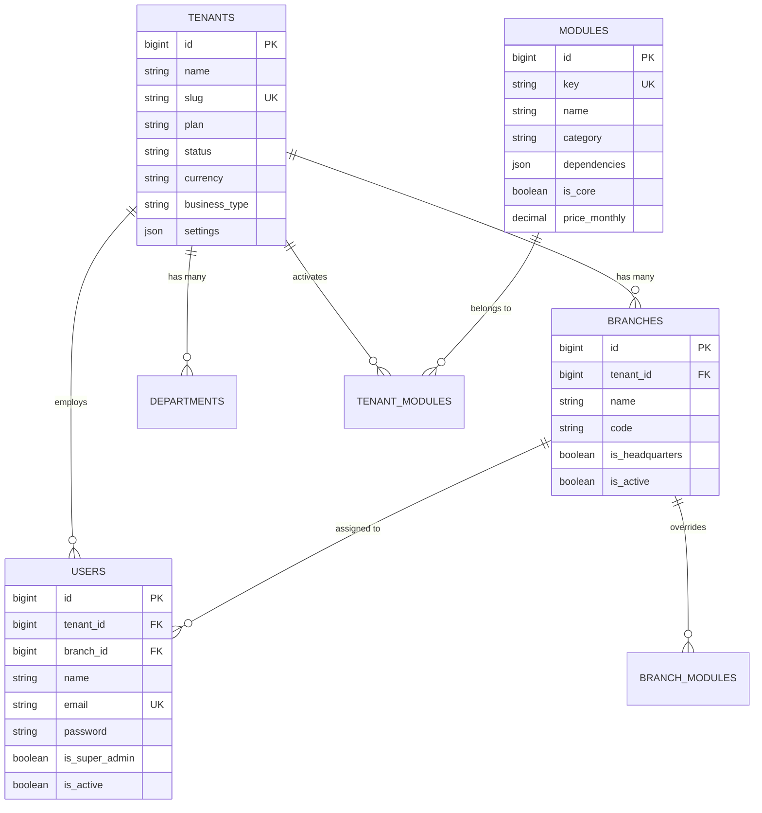
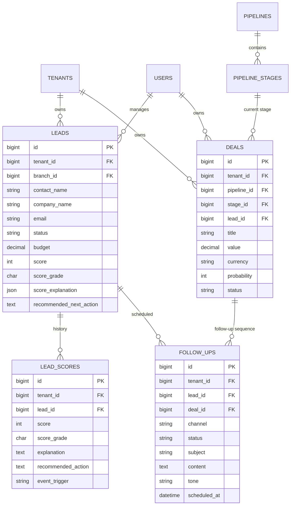
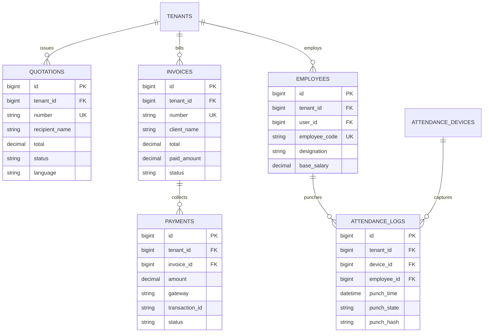

# Entity Relationship Diagram (ERD)

This document visualizes the core database schemas and relationships across the platform using Mermaid diagrams.

---

## 1. Tenancy, Organization & Access Control

---

## 2. AI Sales Core & CRM Pipeline

---

## 3. Commerce, Invoicing & Field People

